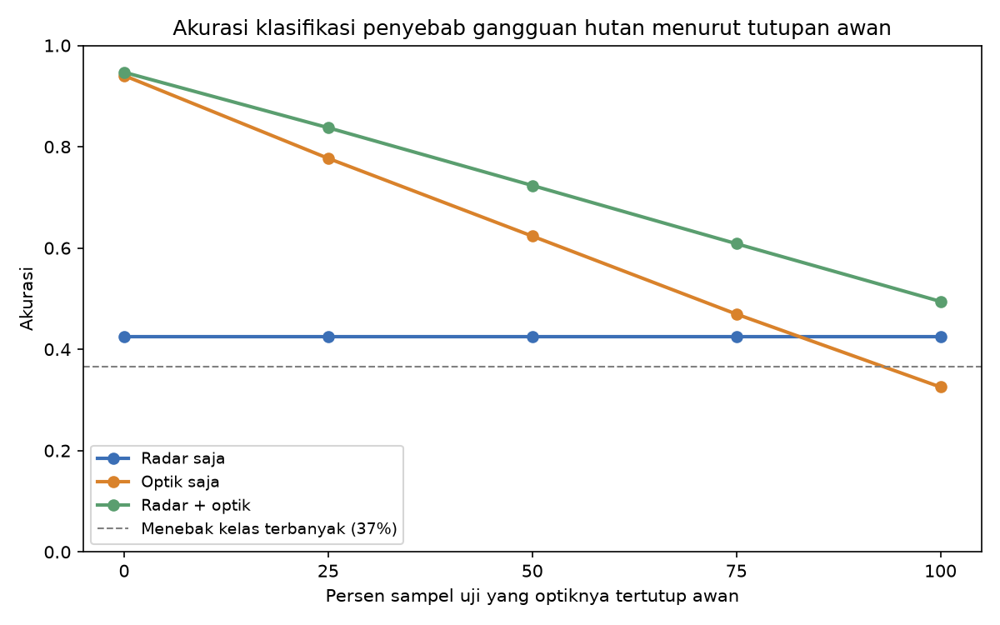
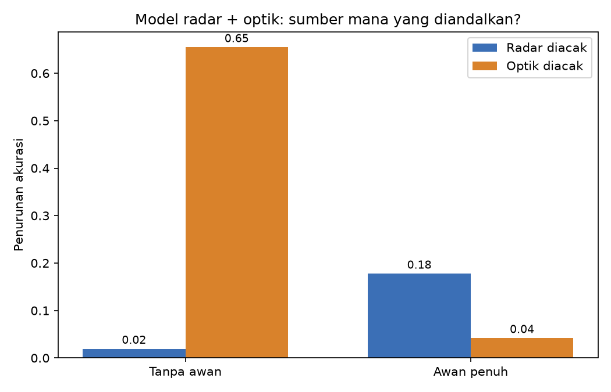
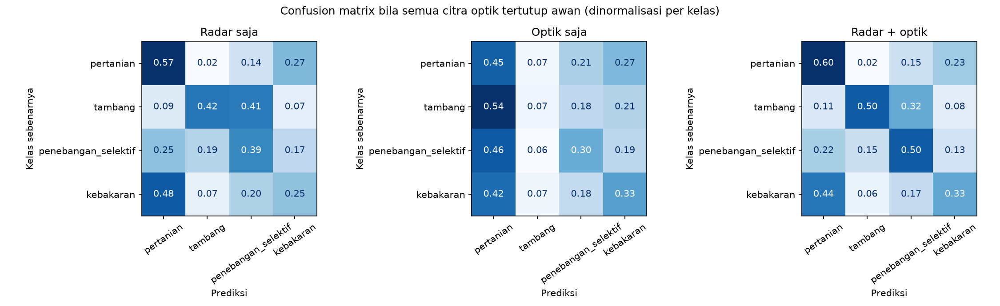

# Menggabungkan Radar dan Optik Saat Citra Tertutup Awan

Studi kasus untuk tugas **Informatics Practitioner Lecture Series 2026** (narasumber: Dr. Bart Slagter, Wageningen University and Research). Di sesi itu dijelaskan bahwa klasifikasi penyebab *deforestation alert* memakai citra radar Sentinel-1 dan optik Sentinel-2 yang ditumpuk menjadi satu citra multiband (2 band radar dan 4 band optik). Saat citra optik tertutup awan, model belajar sendiri mengandalkan radar tanpa diberi tahu secara eksplisit. Project ini meniru logika tersebut dengan data sintetik untuk melihat seberapa besar manfaat penggabungan dua sumber itu.

> **Catatan:** semua data sintetik (dibuat sendiri dengan program). Project ini tidak memakai citra satelit asli dan tidak melatih CNN. Tiap peringatan deforestasi diwakili enam angka (2 radar, 4 optik), dan model yang dipakai adalah Random Forest, supaya yang dibandingkan hanyalah pengaruh sumber data.

## Masalah yang diselesaikan

Sebuah peringatan deforestasi hanya memberi tahu bahwa tutupan pohon hilang, bukan penyebabnya. Bila penyebabnya bisa ditebak dari citra satelit (pertanian, tambang, penebangan selektif, atau kebakaran), tindak lanjutnya bisa lebih tepat. Masalahnya, di daerah tropis citra optik sering tertutup awan. Seberapa besar radar membantu saat itu terjadi?

## Cara kerja

1. **Buat data sintetik.** Tiap sampel punya satu kelas penyebab dan enam fitur:
   - Radar (Sentinel-1): `s1_vv`, `s1_vh`, yaitu perubahan backscatter dalam dB
   - Optik (Sentinel-2): `s2_biru`, `s2_hijau`, `s2_merah`, `s2_nir`, yaitu reflektansi 0 sampai 1
2. **Simulasikan awan.** Nilai optik yang teramati dicampur dengan nilai awan yang sangat terang: `teramati = (1 - f) x asli + f x awan`, dengan f (pecahan yang tertutup) acak antara 0,7 dan 1,0. Radar tidak terpengaruh awan. Setengah data latih dibuat berawan, dan model tidak diberi tahu mana yang berawan.
3. **Latih tiga model** dengan algoritma sama (Random Forest) tetapi masukan berbeda: radar saja, optik saja, dan radar + optik.
4. **Uji pada lima skenario awan.** Data uji dibuat dalam dua versi dari sampel yang sama (bersih dan berawan), lalu dicampur sehingga 0%, 25%, 50%, 75%, atau 100% sampel optiknya tertutup.
5. **Ukur ketergantungan.** Pada model gabungan, kolom radar atau kolom optik diacak lalu dilihat seberapa banyak akurasi turun.

## Struktur folder

```
fusi-radar-optik-awan/
├── README.md
├── requirements.txt
├── data/
│   ├── data_latih.csv
│   ├── data_uji_bersih.csv
│   └── data_uji_berawan.csv
├── hasil/
│   ├── akurasi_vs_awan.csv / .png
│   ├── confusion_awan_penuh.png
│   └── ketergantungan_sumber.csv / .png
└── src/
    ├── config.py          parameter yang bisa diubah
    ├── generate_data.py   membuat data sintetik dan simulasi awan
    ├── evaluate.py        melatih model dan mengevaluasi
    ├── visualize.py       grafik
    └── main.py            program utama
```

## Cara menjalankan

Butuh Python 3.10 atau lebih baru. Jalankan dari folder utama project.

```bash
python -m venv .venv

# Windows
.venv\Scripts\activate
# macOS / Linux
source .venv/bin/activate

pip install -r requirements.txt
python src/generate_data.py
python src/main.py
```

Jumlah data, tingkat awan, dan parameter model ada di `src/config.py`.

## Hasil

Akurasi (4 kelas) menurut persen sampel uji yang optiknya tertutup awan. Menebak kelas terbanyak saja menghasilkan akurasi 0,366.

| Sampel berawan | Radar saja | Optik saja | Radar + optik |
|---|---|---|---|
| 0% | 0,425 | 0,940 | 0,947 |
| 25% | 0,425 | 0,777 | 0,838 |
| 50% | 0,425 | 0,624 | 0,724 |
| 75% | 0,425 | 0,470 | 0,608 |
| 100% | 0,425 | 0,326 | 0,494 |



Temuan utama:

- Optik saja sangat akurat saat langit cerah (0,940), tetapi akurasinya jatuh seiring bertambahnya awan, hingga di bawah tebakan kelas terbanyak pada awan penuh.
- Radar saja tidak terpengaruh awan, tetapi di data ini kemampuannya membedakan kelas memang terbatas (0,425).
- Gabungan radar + optik paling baik di semua skenario. Selisihnya makin besar saat awan makin banyak.
- Pada model gabungan, saat tanpa awan akurasi turun 0,655 bila optik diacak dan hanya 0,019 bila radar diacak. Saat awan penuh polanya berbalik: turun 0,178 bila radar diacak dan hanya 0,042 bila optik diacak. Jadi model beralih mengandalkan radar saat optik tidak bisa dipercaya, tanpa diberi tahu mana sampel yang berawan.




## Keterbatasan

- Data sintetik dengan ciri kelas yang saya tentukan sendiri, jadi angka akurasinya hanya menunjukkan pola, bukan kemampuan sistem nyata. Mengubah ciri kelas di `generate_data.py` akan mengubah angkanya.
- Radar sengaja dibuat lebih lemah daripada optik dalam membedakan kelas, sebagai gambaran umum bahwa radar lebih sulit ditafsirkan. Tingkat kelemahannya adalah asumsi saya, bukan temuan.
- Pada skenario awan penuh, tutupan awan acak antara 70% dan 100%, jadi masih ada sisa sinyal optik. Itu sebabnya model gabungan (0,494) masih sedikit lebih baik daripada radar saja (0,425).
- Model yang dipakai Random Forest pada enam angka per sampel, bukan CNN pada citra. Konteks sekitar peringatan, yang menurut pemateri dibaca model aslinya, tidak ikut disimulasikan.
- Kelas yang dipakai hanya empat dan tidak mencakup banjir atau gangguan alami lain yang disebut di materi.

## Pengembangan lanjutan

- Memakai citra Sentinel-1 dan Sentinel-2 asli dengan label hasil interpretasi manual.
- Mengganti Random Forest dengan CNN yang menerima tumpukan 6 band, seperti di materi, lalu membandingkannya dengan Random Forest sebagai *benchmark* (sesuai saran pemateri).
- Menambah kelas banjir dan kebakaran yang fiturnya tumpang tindih, lalu menguji efek menambah data latih.
- Menambah topeng awan (*cloud mask*) sebagai fitur dan melihat apakah itu membantu model.
